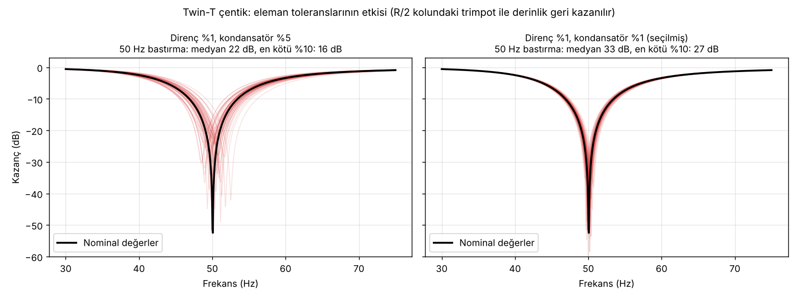
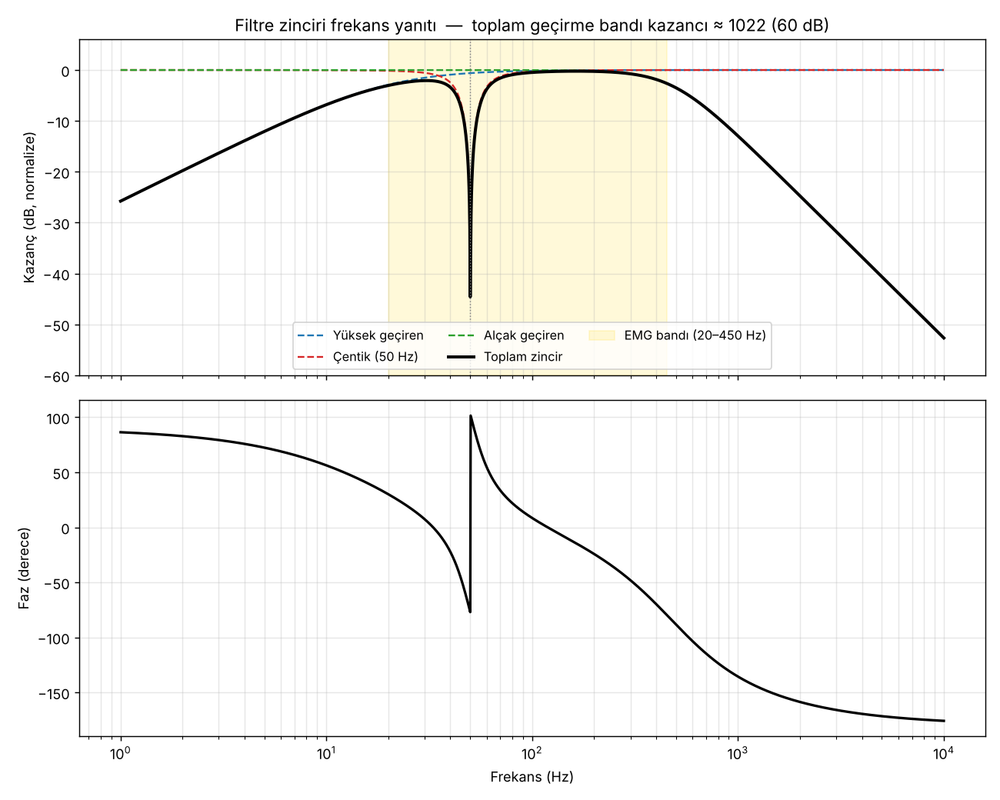
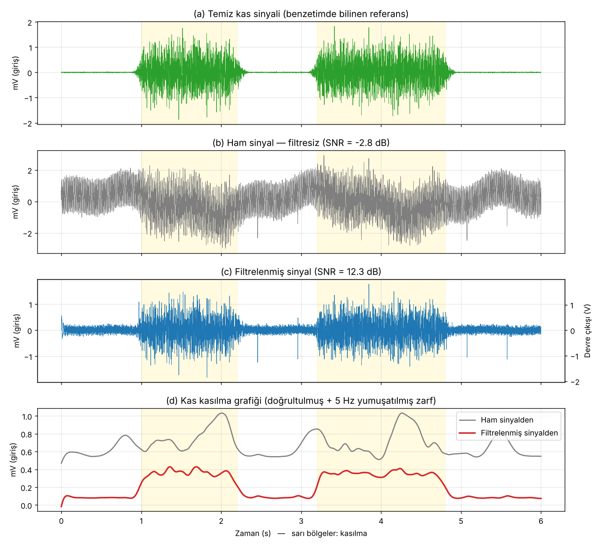
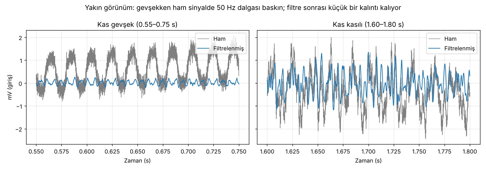
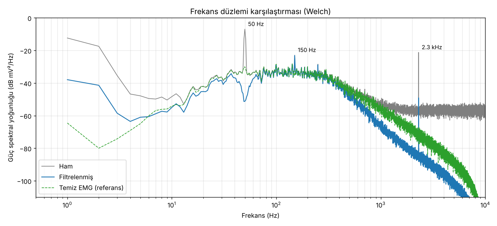

# Kas Kasılma Grafiği ve EMG Sinyal Filtreleme Projesi

Kas kasıldığında oluşan çok küçük (~0,1–2 mV) elektrik sinyalini yüzey elektrotlarıyla alıp
**50 Hz çentik filtre** ve **alçak geçiren filtre** ile temizleyen, sonucu osiloskopta
gösteren analog devre. Filtrenin başarısı zaman/frekans grafikleri ve **SNR** ile sayısal olarak gösterilir.

Devre yalnızca **iki entegre** ile kurulur: **AD620** (yükselteç) + **LM324** (dört op-amp: filtreler ve kazanç).

| Dosya | İçerik |
|---|---|
| `README.md` | Devre, hesaplar, malzeme listesi, bacak bacak bağlantılar, deney adımları, güvenlik |
| `devre.py` | Bileşen değerleri ve her katın transfer fonksiyonu (tek kaynak) |
| `tasarim_hesap.py` | Tüm hesapları yazdırır, Bode diyagramı ve tolerans analizini çizer |
| `simulasyon.py` | Yapay EMG + parazitlerle devrenin bilgisayarda denenmesi, SNR |
| `olcum_analiz.py` | Osiloskoptan alınan gerçek kaydın analizi (grafikler + SNR) |
| `snr.py` | SNR ve zarf hesaplama fonksiyonları |
| `sekiller/` | Üretilen grafikler |

```bash
pip install -r requirements.txt
python tasarim_hesap.py            # hesap tablosu + sekiller/bode.png, centik_tolerans.png
python simulasyon.py               # sekiller/sim_zaman.png, sim_yakin.png, sim_frekans.png
python olcum_analiz.py kayit.csv   # gerçek ölçüm
```

---

## 1. Blok diyagram

```
 Elektrotlar        [1]                 [2]                  [3]                    [4]
 (+)  (−)  (Ref)   AD620       →    Twin-T çentik    →   Sallen-Key alçak   →   Yüksek geçiren   →  Osiloskop
  │    │    │      G = 50,4          f0 = 50 Hz          geçiren, fc = 482 Hz    fc = 19 Hz
  └────┴────┘                        Q = 2,5             K = 1,56                + kazanç x13
                     TP1           LM324 A + B   TP2      LM324 C        TP3     LM324 D        TP4
```

| Kat | Görevi | Neden gerekli |
|---|---|---|
| [1] AD620 | İki elektrot arasındaki farkı yükseltir, iki elektrotta ortak olan 50 Hz'in büyük kısmını atar (CMRR ~100 dB) | EMG çok küçük; şebeke paraziti iki elektrotta da aynı olduğu için fark alınınca büyük ölçüde yok olur |
| [2] Çentik filtre | Fark sinyaline sızan 50 Hz'i bastırır | Projenin ana hedefi: şebeke gürültüsü |
| [3] Alçak geçiren | 500 Hz üstündeki çevresel gürültüyü keser | EMG'nin faydalı enerjisi 20–450 Hz arasındadır |
| [4] Yüksek geçiren + kazanç | Elektrot DC ofsetini ve hareketten kaynaklanan yavaş kaymayı keser, sinyali ~1000 kata çıkarır | 1 mV'lik sinyal osiloskopta ~1 V görünsün |

**Neden bu sıra?** AD620'nin kazancı bilerek düşük (~50) tutuldu: elektrotların DC ofseti onlarca mV
olabilir ve kazanç 1000 olsaydı devre daha ilk katta doyuma giderdi. Bu ofset çentik ve alçak geçirenden
geçerken en fazla ~80 kat büyür (±9 V'ta sorun değil); son kattaki kondansatör DC'yi keser ve
kazancın geri kalanı ancak ondan sonra verilir. Böylece ayrı bir tampon op-amp'e gerek kalmaz ve
tüm filtreler tek bir LM324'e sığar.

Besleme: **iki adet 9 V pil** ile ±9 V (iki pilin birleşim noktası = devre toprağı, GND).

---

## 2. Hesaplar

Tüm değerler `devre.py` içindedir; `python tasarim_hesap.py` aynı hesapları yazdırır.
Bütün dirençler kolay bulunan **E24** serisindendir; gereken yerde iki direnç seri bağlanır.

### [1] AD620 — enstrümantasyon yükselteci

**G = 1 + 49,4 kΩ / RG = 1 + 49,4 / 1,0 = 50,4**  (RG = 1 kΩ, 1 ve 8 numaralı bacaklar arasına)

Elektrot hatlarındaki 10 kΩ seri dirençler hata durumunda vücuttan akabilecek akımı sınırlar
ve AD620 girişlerini korur.

### [2] Aktif Twin-T çentik filtre (50 Hz)

```
                 R = 30k + 1,8k       R = 30k + 1,8k
 TP1 ──┬─────────/\/\/──────┬──────────/\/\/──────┬────── (+) LM324-A ──┬──── TP2
       │                    │                     │       (−) ──────────┤
       │              2C = 2 × 100 nF             │                     │
       │               (paralel)                  │                   Ra 1k
       │                    │                     │                     │
       │                   Vf ◄───────────────────┼──────┐              ●── (+) LM324-B ──┬──► Vf
       │                    │                     │      │              │   (−) ──────────┤
       │        R/2 = 13k + 5k çok turlu trimpot  │      │            Rb 9,1k             │
       │                    │                     │      │              │                 │
       └──────||────────────┴──────────||─────────┘      │             GND                │
          C = 100 nF               C = 100 nF            └────────────────────────────────┘
```

Üst kol R–R, alt kol C–C. Üst kolun ortası **2C** ile, alt kolun ortası **R/2** ile **Vf** düğümüne gider.
Vf, çıkışın k katını süren bir gerilim izleyicidir (LM324-B). Pasif Twin-T'de Vf = toprak olur ve
Q = 0,25 kalır; bu, 20–100 Hz arasındaki kas sinyalini de yer. Geri besleme çentiği daraltır:

- **f0 = 1 / (2π·R·C) = 1 / (2π · 31,8 kΩ · 100 nF) = 50,05 Hz**
- **k = Rb / (Ra + Rb) = 9,1 / 10,1 = 0,901**
- **Q = 1 / (4·(1 − k)) = 2,53** → −3 dB bant genişliği f0/Q ≈ 20 Hz (40–60 Hz)

Transfer fonksiyonu: H(s) = (s² + ω0²) / (s² + 4(1−k)·ω0·s + ω0²)

**Tolerans uyarısı:** Twin-T'nin derinliği elemanların birbirine ne kadar eşit olduğuna bağlıdır.
`tasarim_hesap.py` içindeki Monte Carlo analizi bunu gösterir:



Rastgele %5'lik kondansatörlerle 50 Hz bastırma ~22 dB'e (kötü durumda 16 dB'e) düşer. Bu yüzden:
1. 100 nF kondansatörleri multimetrenin kapasite kademesiyle ölçüp birbirine en yakın 4 tanesini seçin.
2. R/2 kolunu **13 kΩ + 5 kΩ çok turlu trimpot** olarak kurun ve 4. bölümdeki ayar adımıyla çentiği derinleştirin.

### [3] Sallen-Key alçak geçiren

```
                 R = 33k           R = 33k
 TP2 ───────────/\/\/─────┬───────/\/\/─────┬────── (+) LM324-C ──┬──────── TP3
                          │                 │       (−) ──┐       │
                      C = 10 nF         C = 10 nF         ├─ Rf 5,6k ─┘
                          │                 │             │
                          │                GND          Rg 10k
                          └──► TP3'e (geri besleme)       │
                                                         GND
```

Eşit elemanlı tasarım (R1 = R2, C1 = C2):

- **fc = 1 / (2π·R·C) = 1 / (2π · 33 kΩ · 10 nF) = 482 Hz**
- Eşit elemanlı Sallen-Key'de **Q = 1/(3 − K)**. Butterworth (Q = 0,707) için K = 3 − √2 = 1,586 gerekir.
  **K = 1 + Rf/Rg = 1 + 5,6/10 = 1,56** → Q = 0,694 (Butterworth'e çok yakın; fark ölçülemeyecek kadar küçük)

### [4] Yüksek geçiren + kazanç katı

```
 TP3 ──||────┬──── (+) LM324-D ──┬──── TP4 → osiloskop
      1 µF   │     (−) ──┐       │
     (film)  8,2k        ├─ 120k ┘
             │          10k
            GND          │
                        GND
```

- **fc = 1 / (2π · 8,2 kΩ · 1 µF) = 19,4 Hz** (kondansatör kutupsuz film olmalı, elektrolitik değil)
- **G = 1 + 120 kΩ / 10 kΩ = 13**

### Toplam

**G_toplam = 50,4 × 1,56 × 13 ≈ 1022 (60 dB)** → 1 mV'lik kas sinyali çıkışta ~1 V.



| Frekans | 1 Hz | 10 Hz | 20 Hz | **50 Hz** | 100 Hz | 250 Hz | 480 Hz | 1 kHz | 2 kHz | 5 kHz |
|---|---|---|---|---|---|---|---|---|---|---|
| Zayıflatma (dB) | −25,8 | −6,8 | −3,0 | **−46,8** | −0,5 | −0,4 | −3,1 | −13,0 | −24,7 | −40,6 |

(50 Hz değeri ideal, birebir eşleşmiş elemanlar içindir. Gerçek devrede trimpot ayarından sonra 30–40 dB beklenir.)

---

## 3. Malzeme listesi

### Entegreler

| Adet | Malzeme | Not |
|---|---|---|
| 1 | **AD620AN** (DIP-8) | Üretici Analog Devices olmalı |
| 1 (+1 yedek) | **LM324N** (DIP-14) | Dört op-amp. Ucuz, yedek almak mantıklı. TL074 de birebir takılır. |

### Dirençler — 1/4 W, %1 metal film

| Değer | Adet | Nerede |
|---|---|---|
| **10 kΩ** | **10** | 3 elektrot koruması, Sallen-Key Rg, kazanç Rg, 4 LM324 çıkış direnci, 1 test bölücü |
| 1 kΩ | 2 | AD620 RG, Twin-T Ra |
| 30 kΩ | 2 | Twin-T R (1,8k ile seri) |
| 1,8 kΩ | 2 | Twin-T R (30k ile seri) |
| 13 kΩ | 1 | Twin-T R/2 (trimpot ile seri) |
| 9,1 kΩ | 1 | Twin-T Rb |
| 33 kΩ | 2 | Sallen-Key R |
| 5,6 kΩ | 1 | Sallen-Key Rf |
| 8,2 kΩ | 1 | Yüksek geçiren |
| 120 kΩ | 1 | Kazanç Rf |
| 100 Ω | 1 | Test bölücü (sinyal jeneratörünü ~10 mV'a indirmek için) |
| **5 kΩ çok turlu trimpot** (3296 tipi, üzerinde "502") | 1 | Çentik ayarı |

Dirençler genellikle 10'lu paketlerle satılır. Birçok değer gerektiği için **%1 metal film direnç seti**
almak daha ucuz olabilir; setin yukarıdaki değerleri (özellikle 1,8k, 9,1k, 13k, 30k) içerdiğini kontrol edin.

### Kondansatörler

| Değer | Adet | Tip | Nerede |
|---|---|---|---|
| **100 nF** | **8** (4 kullanılacak) | **Polyester/film** | Twin-T. Ölçüp birbirine en yakın 4 tanesini seçin. |
| 10 nF | 4 (2 kullanılacak) | Polyester/film | Sallen-Key |
| 1 µF | 2 (1 kullanılacak) | Polyester/film, **kutupsuz** | Yüksek geçiren |
| 100 nF | 4 | Seramik | Entegrelerin besleme bacaklarına (dekuplaj) |
| 10 µF | 2 | Elektrolitik, ≥ 16 V | Pil girişlerine |

### Elektrot ve bağlantı

| Malzeme | Not |
|---|---|
| **Ag/AgCl jelli EKG elektrodu**, 20 adet | Eczane veya medikal malzemeci; tek kullanımlık |
| 3 adet **çıtçıtlı (snap) EKG elektrot kablosu** | Yoksa elektrot çıtçıtına timsah kıskaç veya lehimli kablo |

### Güç ve montaj

| Malzeme | Not |
|---|---|
| 2 × 9 V pil + 2 pil başlığı | ±9 V |
| 830 delikli breadboard | |
| Erkek-erkek jumper kablo seti | Kısa kablolar tercih edin |
| (İsteğe bağlı) delikli pertinaks + 8 ve 14 bacaklı DIP soket | Kalıcı, lehimli sürüm için; lehimli devre daha az gürültü toplar |

### Laboratuvardan

Osiloskop (CSV kaydedebilen, FFT fonksiyonu olan), sinyal jeneratörü, kapasite ölçebilen multimetre.

---

## 4. Bacak bacak bağlantılar

**Entegre bacak numaraları** (çentik yukarıda, sol üstten saat yönünün tersine):

```
        AD620                               LM324
     ┌───╮╭───┐                          ┌───╮╭───┐
  RG │1      8│ RG              OUT A    │1     14│ OUT D
 −IN │2      7│ +9 V            −IN A    │2     13│ −IN D
 +IN │3      6│ OUT             +IN A    │3     12│ +IN D
−9 V │4      5│ REF             +9 V     │4     11│ −9 V
     └────────┘                 +IN B    │5     10│ +IN C
                                −IN B    │6      9│ −IN C
                                OUT B    │7      8│ OUT C
                                         └────────┘
```

| Nereden | Nereye | Parça |
|---|---|---|
| **Besleme** | | |
| Pil-1 (+) | +9 V hattı | |
| Pil-1 (−) ve Pil-2 (+) | GND hattı | |
| Pil-2 (−) | −9 V hattı | |
| +9 V ve −9 V hatları | GND | Her birine 10 µF (eksi ucu: +9'da GND'ye, −9'da −9 V'a) |
| AD620 bacak 7 | +9 V | + 100 nF seramik GND'ye |
| AD620 bacak 4 | −9 V | + 100 nF seramik GND'ye |
| LM324 bacak 4 | +9 V | + 100 nF seramik GND'ye |
| LM324 bacak 11 | −9 V | + 100 nF seramik GND'ye |
| **[1] AD620** | | |
| Elektrot (+) | AD620 bacak 3 | 10 kΩ |
| Elektrot (−) | AD620 bacak 2 | 10 kΩ |
| Referans elektrot | GND | 10 kΩ |
| AD620 bacak 1 | AD620 bacak 8 | RG = 1 kΩ |
| AD620 bacak 5 (REF) | GND | |
| AD620 bacak 6 | **TP1** | |
| **[2] Twin-T + LM324 A, B** | | |
| TP1 | düğüm M1 | 30k + 1,8k seri |
| M1 | LM324 bacak 3 | 30k + 1,8k seri |
| TP1 | düğüm M2 | 100 nF film |
| M2 | LM324 bacak 3 | 100 nF film |
| M1 | LM324 bacak 7 (Vf) | 2 × 100 nF film, paralel |
| M2 | LM324 bacak 7 (Vf) | 13k + 5k trimpot, seri |
| LM324 bacak 2 | LM324 bacak 1 | kablo (izleyici) |
| LM324 bacak 1 = **TP2** | LM324 bacak 5 | Ra = 1 kΩ |
| LM324 bacak 5 | GND | Rb = 9,1 kΩ |
| LM324 bacak 6 | LM324 bacak 7 | kablo (izleyici) |
| **[3] Sallen-Key + LM324 C** | | |
| TP2 (bacak 1) | düğüm N1 | 33 kΩ |
| N1 | LM324 bacak 10 | 33 kΩ |
| N1 | LM324 bacak 8 | 10 nF film |
| LM324 bacak 10 | GND | 10 nF film |
| LM324 bacak 9 | GND | Rg = 10 kΩ |
| LM324 bacak 9 | LM324 bacak 8 | Rf = 5,6 kΩ |
| LM324 bacak 8 = **TP3** | | |
| **[4] Yüksek geçiren + kazanç, LM324 D** | | |
| TP3 (bacak 8) | LM324 bacak 12 | 1 µF film |
| LM324 bacak 12 | GND | 8,2 kΩ |
| LM324 bacak 13 | GND | 10 kΩ |
| LM324 bacak 13 | LM324 bacak 14 | 120 kΩ |
| LM324 bacak 14 = **TP4** | osiloskop | |
| **LM324 çıkış dirençleri** (sıfır geçiş bozulmasını önler) | | |
| LM324 bacak 1, 7, 8, 14 | −9 V | her birine ayrı 10 kΩ |

---

## 5. Deney adımları

**A. Kat kat test (henüz vücuda bağlamadan, sinyal jeneratörüyle)**

1. ±9 V beslemeyi bağlayın; her entegrenin besleme bacaklarını multimetreyle ölçün.
2. **AD620 testi:** jeneratörü 10 kΩ / 100 Ω bölücüyle ~10 mV'a indirip AD620 bacak 3'e verin
   (bacak 2 ve referans GND'de). TP1'de ~0,5 V görmelisiniz (G ≈ 50).
3. **AD620 CMRR testi:** bacak 2 ve 3'ü birleştirip ikisine birden 1 V, 50 Hz verin. TP1'de en fazla birkaç mV
   görmelisiniz. Onlarca mV görüyorsanız entegre büyük ihtimalle sahte veya bozuk.
4. **Filtre yanıtı:** AD620 çıkışını TP1'den ayırın, jeneratörden 1 Vpp sinüsü doğrudan TP1'e verin.
   10, 20, 50, 100, 250, 480, 1000, 2000 Hz'de TP4'teki genliği ölçün;
   `kazanç(dB) = 20·log10(V_TP4 / V_TP1) − 20·log10(20,3)` ile normalize edip
   (20,3 = 1,56 × 13) yukarıdaki tabloyla karşılaştırın. Ölçülen noktaları Bode grafiğinin üzerine işleyin.
5. **Çentik ayarı:** jeneratörü 50,0 Hz'e ayarlayın, TP2'yi izleyerek trimpotu çıkış en küçük olana kadar çevirin.
6. AD620'yi tekrar TP1'e bağlayın.

**B. Elektrot yerleşimi (biseps)**

- Cildi alkolle silin. İki ölçüm elektrodunu biseps kasının ortasına, kas lifleri boyunca **2–3 cm arayla** yapıştırın.
- Referans elektrodunu kemikli bir bölgeye (dirsek) yapıştırın.
- Kabloları birbirine sarın/örün ve kısa tutun; kablo hareketi parazit üretir.

**C. Osiloskop ile kayıt**

| Ayar | CH1 = TP1 (ham) | CH2 = TP4 (filtreli) |
|---|---|---|
| Kuplaj | AC | AC |
| Volt/div | 50 mV | 500 mV |
| Zaman/div | 500 ms (ekranda 5 s) | |

1. Kas gevşekken ekranı izleyin: CH1'de belirgin bir 50 Hz dalgası, CH2'de neredeyse düz çizgi beklenir.
2. Kası 1–2 s kasın, 1–2 s gevşetin; birkaç kez tekrarlayın.
3. Osiloskopun **FFT (Math)** fonksiyonuyla her iki kanalın spektrumunu görün: 50 Hz tepesi CH2'de kaybolmalı.
4. Kaydı **CSV** olarak USB belleğe kaydedin (iki kanal aynı dosyada).
5. Analiz: `python olcum_analiz.py kayit.csv` → SNR değerleri ve grafikler.
   Sütunlar farklıysa `--zaman 0 --ham 1 --filtreli 2`, bölgeleri elle vermek için
   `--kasilma 1.2:2.5,4:5.3 --dinlenme 0:0.8,2.8:3.6` kullanın.

### SNR nasıl hesaplanıyor?

Gerçek ölçümde "temiz" sinyali bilmeyiz; bu yüzden kas gevşekken kaydedilen her şeyi gürültü kabul ederiz:

```
P_gürültü = P_dinlenme
P_sinyal  = P_kasılma − P_dinlenme
SNR (dB)  = 10 · log10( P_sinyal / P_gürültü )
```

Aynı formül ham (TP1) ve filtrelenmiş (TP4) kanala uygulanır; aradaki fark filtrenin SNR kazancıdır.
SNR bir oran olduğu için kanalların kazançlarının farklı olması sonucu etkilemez.

---

## 6. Benzetim sonuçları

`simulasyon.py`, gerçekçi bir yapay EMG sinyali (kasılma sırasında 0,5 mV RMS) üzerine projede
sayılan parazitleri ekler ve tasarlanan devreden geçirir (nominal eleman değerleriyle):

| Parazit | Filtre öncesi (RMS) | Filtre sonrası (RMS) | Bastırma |
|---|---|---|---|
| Şebeke 50 Hz (temel) | 0,566 mV | 0,003 mV | **45,3 dB** |
| Şebeke harmonikleri (150/250 Hz) | 0,092 mV | 0,089 mV | 0,3 dB |
| Hareket / taban kayması (< 2 Hz) | 0,482 mV | 0,017 mV | 29,2 dB |
| Ani parazitler (1,5 ms darbe) | 0,046 mV | 0,038 mV | 1,6 dB |
| Yüksek frekans gürültü (geniş bant + 2,3 kHz) | 0,184 mV | 0,033 mV | 15,1 dB |

| SNR | Filtre öncesi | Filtre sonrası | İyileşme |
|---|---|---|---|
| Temiz sinyal bilinerek | −6,9 dB | 9,5 dB | **+16,4 dB** |
| Kasılma / dinlenme yöntemi (ölçümde kullanılacak) | −2,8 dB | 12,3 dB | **+15,1 dB** |



Alt paneldeki **kas kasılma grafiği**, projede beklenen "kası kastığımızda yükselen, gevşettiğimizde
düzleşen" eğridir: ham sinyalden çıkarılan zarf gürültü yüzünden kasılmayı ayırt edemezken
filtrelenmiş sinyalinki net biçimde yükselip iniyor.





### Benzetimin gösterdiği sınırlar (raporda tartışılabilir)

- **Harmonikler geçiyor:** Çentik yalnızca 50 Hz'i bastırır; 150 Hz ve 250 Hz EMG bandının içinde olduğu için
  alçak geçiren de onlara dokunmaz. Gerekirse ikinci bir 150 Hz Twin-T eklenebilir.
- **Bant içi gürültü kalır:** 20–480 Hz arasındaki gürültü, sinyalle aynı frekanslarda olduğu için hiçbir filtre
  tarafından ayrılamaz. Asıl iyileştirme kaynağı düzgün elektrot teması ve kısa/örülü kablolardır.
- **Kısa darbeler:** 1–2 ms'lik ani parazitlerin enerjisi EMG bandına düştüğü için alçak geçiren onları ancak biraz yumuşatır.
- **Eleman toleransları:** Benzetim nominal değerlerle yapıldı; gerçek devrede 50 Hz bastırması trimpot ayarına bağlıdır.

### Geliştirme fikirleri

- **Sağ bacak sürücüsü (DRL):** Referans elektrodunu ortak mod gerilimiyle ters sürerek 50 Hz'i kaynağında azaltır.
- **Analog zarf devresi:** Hassas doğrultucu + 5 Hz alçak geçiren ile "kas kasılma grafiği" doğrudan osiloskopta görünür.
- **4. derece alçak geçiren:** İki Sallen-Key art arda (Q = 0,541 ve 1,307) ile −80 dB/dekad.

---

## 7. Güvenlik

- Devreyi **yalnızca pille** besleyin. Elektrotlar vücuttayken devreyi **asla** prize bağlı bir adaptöre bağlamayın.
- Masaüstü osiloskopun toprak ucu şebeke toprağına bağlıdır; bu, referans elektrot üzerinden kişiyi toprağa bağlar.
  Normal çalışmada sorun yaratmaz, ancak bu yüzden elektrot hatlarındaki **10 kΩ seri dirençleri atlamayın**.
  Mümkünse pille çalışan el osiloskobu veya şarjı takılı olmayan dizüstü bilgisayara bağlı USB osiloskop kullanın.
- Elektrotların hepsini **aynı kola** yapıştırın; göğüs üzerinden (kolun birinden diğerine) bağlantı yapmayın.
- Kalp pili veya başka implantı olan kişilerde denemeyin.
